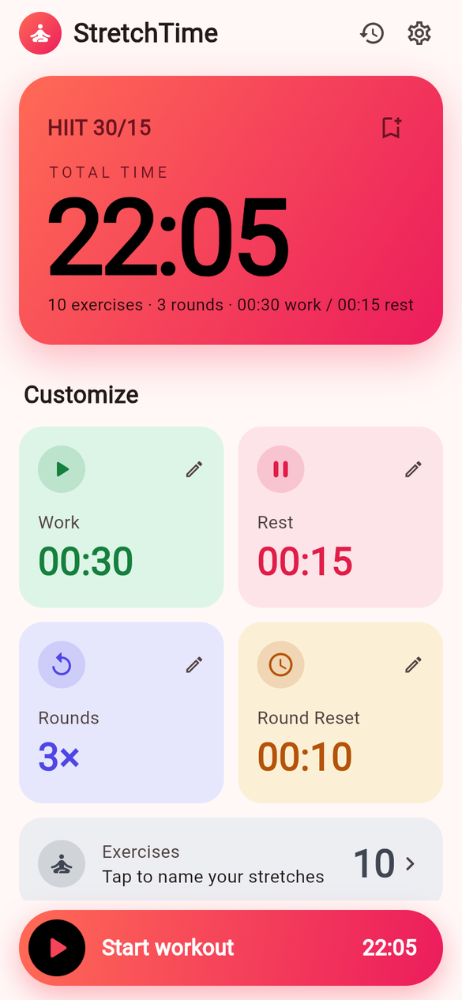
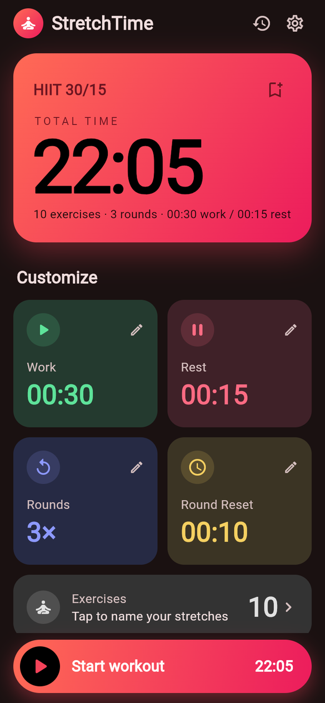
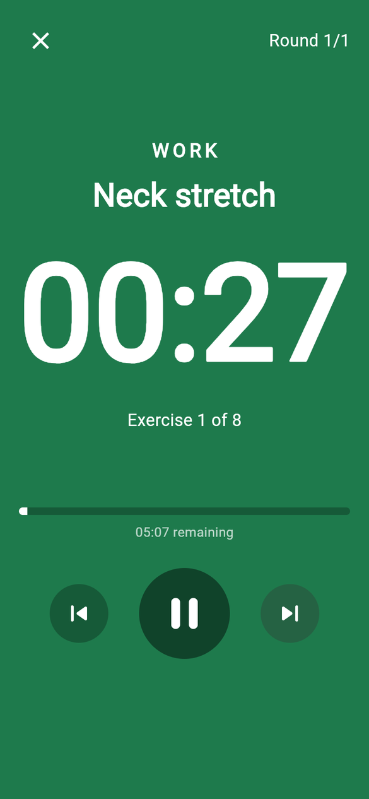
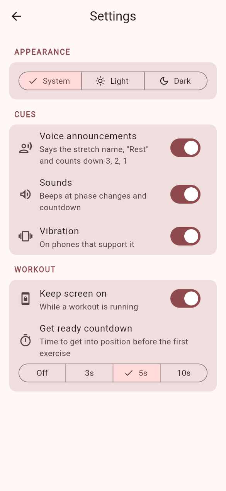
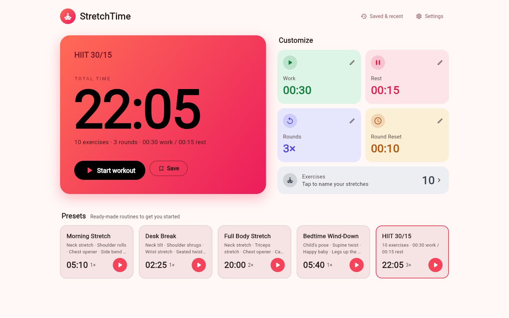

# StretchTime

Interval timer for stretching and workouts — one Flutter codebase for Android, iOS and web.

**[Open the web app](https://stretch-time.bikal3.com.np/)** · **[Download the Android APK (latest release)](https://github.com/bikal3/stretch-time/releases/latest)**

<p>
  
  
  
  
</p>



## Features

- Work / Rest / Exercises / Rounds / Round Reset timer
- Name each stretch; the timer shows and announces the current and next one
- A posture picture and form tips (ⓘ) for every built-in stretch
- Both-sides stretches: left, a "Switch sides" cue, then right
- Streak, a week of day dots, and minutes in the last 7 days
- Voice cues, beeps and vibration that mix with your music
- Daily reminder on Android and iPhone, skipped once you've stretched
- Built-in presets, saved workouts and recent history
- Light, dark or system theme
- Desktop web layout with keyboard shortcuts: Space pause, ← → back/skip, Esc end

## Get it

| Platform | How |
|----------|-----|
| Web | https://stretch-time.bikal3.com.np/ — on a phone, use *Add to Home Screen* / *Install app* |
| Android | Download the APK from [Releases](https://github.com/bikal3/stretch-time/releases/latest), open it, allow installs from that source |
| iPhone | Build from source with Xcode (see below); not on the App Store yet |

## Run

```sh
flutter run -d chrome        # web
flutter run                  # connected phone / simulator
flutter test                 # timer logic tests
```

## Build

```sh
flutter build web --release  # output: build/web — upload to any static host (Netlify, GitHub Pages, Cloudflare Pages)
flutter build apk --release  # Android APK, debug-signed (Play Store needs a release key + flutter build appbundle)
flutter build ipa            # iOS (needs an Apple Developer account for signing)
```

The web app deploys automatically: every push to `main` runs the tests and publishes
https://stretch-time.bikal3.com.np/ via `.github/workflows/deploy-web.yml`
(re-run it from the Actions tab → Deploy web → Run workflow).

Install on your own devices:

```sh
# Android: download the APK from GitHub Releases, or with a phone on USB debugging:
flutter install --release
# iPhone: update in place (keeps saved workouts; `flutter install` uninstalls first)
flutter build ios --release && xcrun devicectl device install app --device <UDID> build/ios/iphoneos/Runner.app
```

App icons come from `assets/icon.png`; regenerate with `dart run flutter_launcher_icons`.

## Code

- `lib/workout.dart` — workout model, plan builder, timer engine, built-in presets (pure Dart, tested)
- `lib/app_state.dart` — settings, saved & recent workouts (persisted with shared_preferences)
- `lib/main.dart` — home screen (phone and desktop layouts), theme
- `lib/run_screen.dart` — running timer, voice/sound/vibration cues
- `lib/reminder.dart` — daily reminder notifications
- `lib/sheets.dart` — value editor, presets sheet, exercises editor, settings
